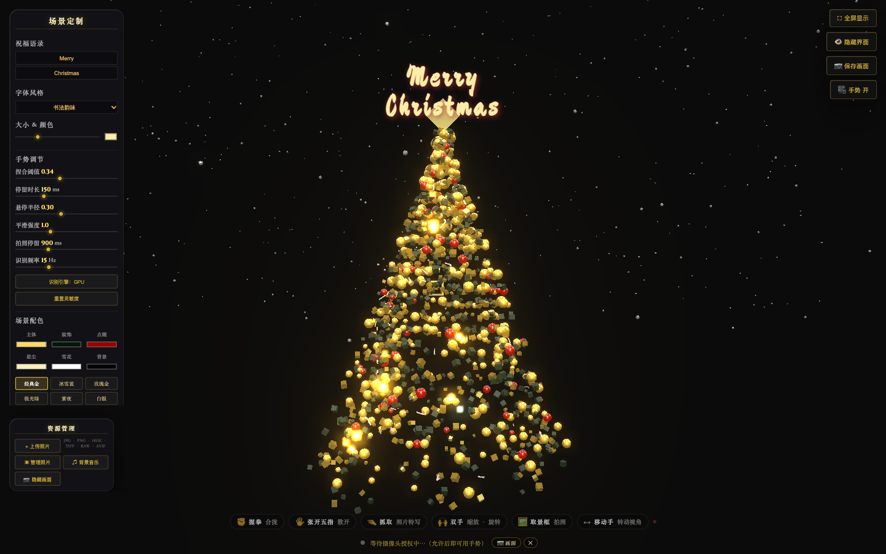
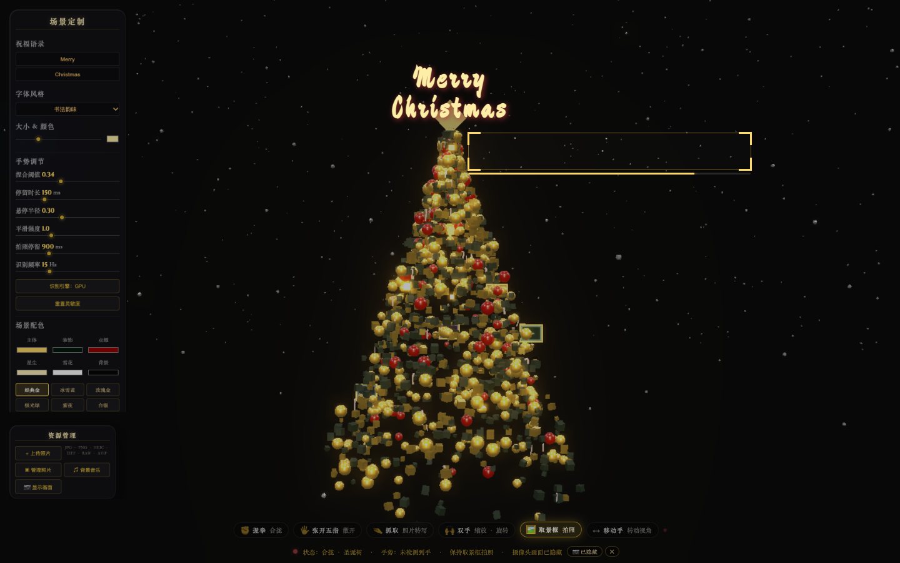
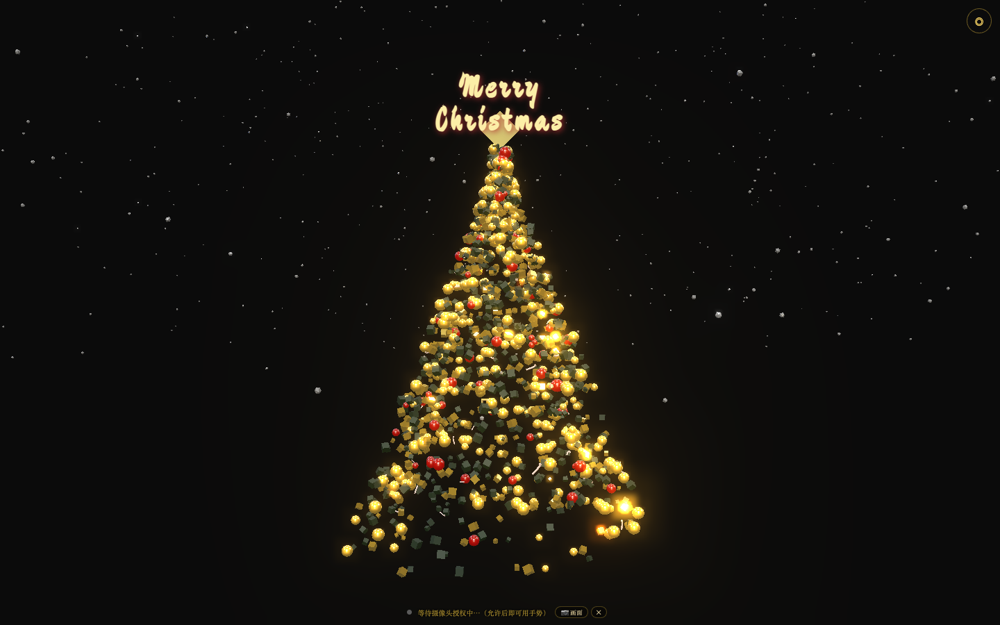
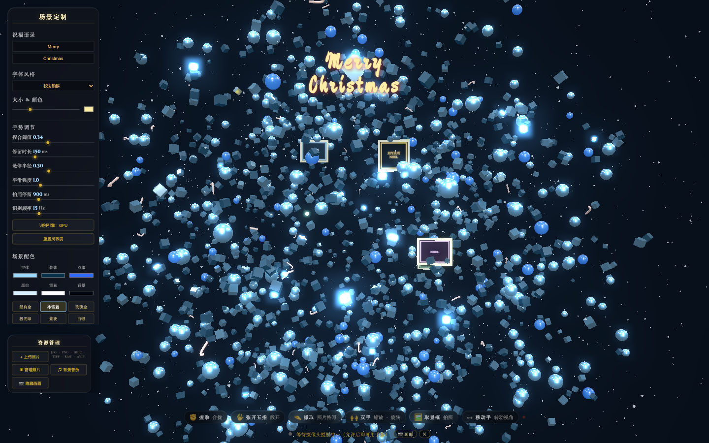
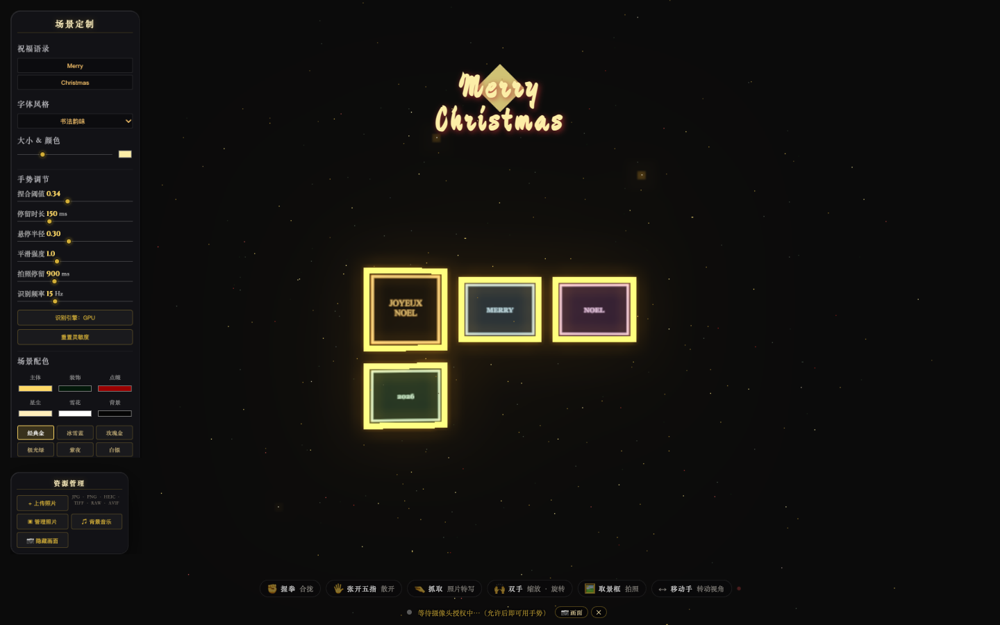

# 🎄 Christmas Tree 使用说明

> 一棵可以用手势摆弄的 3D 圣诞树：合拢成树、张开成星云、捏住一张照片看特写、双手缩放旋转，甚至比个取景框就能拍照。
>
> **单个 HTML 文件，13.8 MB，双击即开，断网可用，不含任何外部请求。**

---

## 目录

1. [这是什么](#1-这是什么)
2. [快速开始](#2-快速开始)
3. [界面地图](#3-界面地图)
4. [四种场景形态](#4-四种场景形态)
5. [手势操作](#5-手势操作)
6. [键盘快捷键](#6-键盘快捷键)
7. [左侧控制面板详解](#7-左侧控制面板详解)
8. [照片：上传与格式支持](#8-照片上传与格式支持)
9. [音乐与频谱律动](#9-音乐与频谱律动)
10. [性能：为什么开手势会掉帧](#10-性能为什么开手势会掉帧)
11. [常见问题 FAQ](#11-常见问题-faq)
12. [数据与隐私](#12-数据与隐私)
13. [技术说明（开发者）](#13-技术说明开发者)
14. [版本记录](#14-版本记录)

---

## 1. 这是什么

一个纯前端的三维场景文件，把圣诞树做成**粒子**：

- 1500 个装饰粒子 + 2500 个星尘粒子 + 1500 片雪，全部由 GPU 实例化渲染；
- 四种形态之间**带缓动动画**平滑过渡（合拢 / 散开 / 照片特写 / 照片墙）；
- 摄像头识别手掌，用手势代替鼠标；
- 照片会像挂饰一样挂在树冠上，可以抓出来看特写；
- 背景音乐可以驱动粒子随节拍跳动；
- 配色、文案、粒子数、手势灵敏度都能现场调，设置自动记住。

所有依赖（three.js、MediaPipe 手部模型、字体、HEIC/RAW 解码器）都被打包进了同一个 HTML 里，**没有任何 CDN、没有外链、不需要联网**。

---

## 2. 快速开始

### 2.1 电脑（推荐 Chrome / Edge）

1. 双击 `Creamers-tree.html`，会用默认浏览器打开；
2. 首次打开浏览器会询问**摄像头权限**，点「允许」；
3. 等 1～3 秒（首次要解压内置的手部模型，解压后约 16 MB），粒子树出现即可使用。

> 如果双击打开的是 Safari，建议先切到 Chrome：Safari 对 `file://` 页面的摄像头和 IndexedDB 限制较多。

### 2.2 手机 / 平板

单文件在手机上也能**看**，但**摄像头手势需要 HTTPS**（浏览器安全策略，`file://` 页面拿不到摄像头）。两种做法：

| 目的 | 做法 |
|---|---|
| 只想展示/截图 | 把 HTML 发到手机上，用浏览器打开即可（无手势） |
| 想用手势 | 上传到任意 HTTPS 静态托管（GitHub Pages / Netlify / Vercel），或本机跑 `python3 -m http.server` + 内网穿透 |

手机上窄屏（≤560px）会自动收起侧栏，点右上角 **◎** 展开面板。

### 2.3 浏览器要求

| 浏览器 | 要求 | 说明 |
|---|---|---|
| Chrome / Edge | 103+ | 最佳体验，推荐 |
| Safari | 16.4+ | 需要 `DecompressionStream`；HEIC 可原生解码 |
| Firefox | 113+ | 可用 |

需要支持 **WebGL2**、**Web Audio**、**IndexedDB**。

---

## 3. 界面地图



| 区域 | 内容 |
|---|---|
| **左上 · 侧栏** | 场景定制 / 手势调节 / 场景配色 / 背景音乐 / 粒子控制 / 交互中控，可上下滚动 |
| **左下 · 资源管理** | 上传照片、管理照片、背景音乐、隐藏画面（固定停靠，永远可见） |
| **右上 · 快捷按钮** | 全屏、隐藏界面、保存画面、手势开关（静止 4.5 秒自动淡出） |
| **底部居中 · 手势胶囊条** | 当前识别到的手势高亮 |
| **最底 · 状态条** | 场景状态 + 手势 + 识别帧率，右侧有「📷 摄像头画面」与「✕ 关闭」 |
| **右下 · 摄像头预览** | 镜像画面 + 彩色骨架线（可隐藏） |

---

## 4. 四种场景形态

| 形态 | 进入方式 | 效果 |
|---|---|---|
| 🌲 **合拢（TREE）** | 握拳 / `SPACE` / 点「合拢」 | 粒子螺旋聚合成圣诞树，缓慢自转，飘雪 |
| ✨ **散开（SCATTER）** | 张开五指 / `Z` / 点「散开」 | 粒子扩散成星云，可左右上下转动视角 |
| 🖼 **照片特写（FOCUS）** | 捏合 / `X` / 点「抓取照片」 | 最近的那张照片飞到镜头前放大，其余粒子后退让位 |
| 🧱 **照片墙（WALL）** | 按钮 / `W` | 所有照片排成网格，双手拖动平移、拉开缩放，适合当相册 |

过渡动画：合拢 ↔ 散开 **1.15 秒**（缓动 + 每个粒子错峰 0.42，形成涟漪），照片飞入 **0.55 秒**，相机同时做推拉（50 → 55 → 47.5 → 40）。

---

## 5. 手势操作

> 建议：手掌正对摄像头，距离 40～80 cm，光线充足（背光最难识别）。

### 5.1 单手

| 手势 | 图示 | 动作 | 判定方式 |
|---|---|---|---|
| **握拳** | ✊ | → 合拢成树 | 伸指数 ≤1 且指尖贴近掌心 |
| **张开五指** | 🖐 | → 散开成星云 | 四指伸直 + 拇指张开 |
| **捏合** | 🤏 | → 抓住照片看特写 | 拇指尖与食指尖距离 < 0.34 倍手掌长度 |
| **移动手** | ↔ | 散开态下转动视角 | 手掌位置偏离中心的距离（带 0.16 死区） |

### 5.2 双手

| 手势 | 动作 |
|---|---|
| 🙌 双手**都张开** | 进入「双指」模式 |
| ↔ **两手拉开 / 靠近** | 放大 / 缩小画面（拉开 = 放大，0.55×～2.0×） |
| ↻ **两手连线转动** | 旋转画面 |
| ↕ **两手整体上下** | 俯仰视角 |
| ✊✊ 双手**都握拳** | 回到合拢 |
| 🤏🤏 双手**都捏合** | 在照片特写里缩放那张照片 |

> 检测到两只手时，单手手势会自动让位，避免打架。

### 5.3 取景框拍照 📷



1. 两只手各伸出**食指 + 拇指**，比成一个「L 形取景框」；
2. 屏幕上会出现金色取景框（跟着两个食指尖），框外自动压暗，框底有进度条；
3. 保持 **900 ms**（可调），进度条满 → 闪光 + 「咔嚓」声 + 自动保存 PNG。

快门声是 WebAudio 现场合成的（两段方波咔哒 + 噪声尾巴），不依赖任何音频文件。

### 5.4 底部状态条



| 状态点 | 含义 |
|---|---|
| 🟢 绿 | 正在跟踪手 |
| ⚪ 灰 | 模型就绪，但没检测到手 |
| 🔴 红 | 没有摄像头 / 画面被关闭 |

右侧两个按钮：**📷 画面**（摄像头三态切换）、**✕ 关闭状态条**。

---

## 6. 键盘快捷键

| 键 | 功能 |
|---|---|
| `SPACE` | 合拢 |
| `Z` | 散开 |
| `X` | 抓取照片 |
| `W` | 照片墙 |
| `H` | 隐藏 / 显示界面 |
| `D` | 隐藏 / 显示底部状态条 |
| `C` | 摄像头画面切换：画面+骨架 → 仅骨架 → 隐藏 |
| `B` | 频谱联动开关 |
| `P` | 保存当前画面（PNG） |
| `G` | 手势识别总开关 |
| `↑ ↓ ← →` | 旋转视角（按住持续转） |

> 没有摄像头时，键盘 + 左侧按钮可以完整操作所有功能。

---

## 7. 左侧控制面板详解

### 7.1 场景定制

- **祝福语录**：两行文字，实时生效，自动保存；
- **字体风格**：书法韵味 / 古典衬线 / 优雅手写 / 艺术线条 / 复古重磅（5 套字体已内联，离线可用）；
- **大小 & 颜色**：字号 50–250、文字颜色。

### 7.2 手势调节

| 参数 | 默认 | 范围 | 作用 | 调不好时 |
|---|---|---|---|---|
| 捏合阈值 | 0.34 | 0.18–0.55 | 越小越容易触发「抓取」 | 抓不住 → 调大；总误触 → 调小 |
| 停留时长 | 150 ms | 60–400 | 手势要保持多久才生效 | 手抖误触发 → 调大 |
| 悬停半径 | 0.30 | 0.10–0.55 | 手离照片多近算「悬停预览」 | 选不中 → 调大 |
| 平滑强度 | 1.0 | 0.5–2.0 | 越大越稳但更迟滞 | 抖 → 调大；慢 → 调小 |
| 拍照停留 | 900 ms | 400–2000 | 取景框保持多久触发快门 | 手不稳 → 调大 |
| **识别频率** | **15 Hz** | 8–30 | 每秒跑几次手部推理 | 卡 → 调小 |
| **识别引擎** | GPU | GPU / CPU | GPU 快但抢显卡；CPU 稳但慢 | 掉帧 → 切 CPU |

「重置灵敏度」一键恢复默认。

### 7.3 场景配色



6 个取色器（主体 / 装饰 / 点缀 / 星尘 / 雪花 / 背景）+ 6 套预设：

**经典金 · 冰雪蓝 · 玫瑰金 · 极光绿 · 紫夜 · 白银**

改色会同时影响：粒子材质与自发光、树顶星、雪花、照片边框、背景与雾、**以及整个 UI 的强调色**。

### 7.4 背景音乐 / 频谱律动

| 控件 | 作用 |
|---|---|
| ⏯ / ⟲ | 播放暂停 / 重播 |
| 音量调节 | 0–100 |
| 🎵 频谱联动 | 总开关 |
| **总强度** | 整体倍率 |
| **低频律动** | 整组缩放脉冲 + 泛光（鼓点感） |
| **中频律动** | 金色粒子自发光（人声/旋律） |
| **高频律动** | 星尘闪烁（镲片/齿音） |

支持 `.mp3 .m4a .aac .wav .ogg .flac .opus`。音频在**第一次点击或按键**时解锁（浏览器自动播放策略）。

### 7.5 粒子控制

装饰密度（500–3000）、星尘密度、雪花数量 / 大小 / 下落速度。「⚡ 重置场景」重新随机分布。

### 7.6 交互中控

合拢 / 散开 / 抓取照片 / 照片墙四个按钮 + 旋转速度 + 八向方向盘。

### 7.7 资源管理（固定在侧栏底部）

| 按钮 | 说明 |
|---|---|
| **+ 上传照片** | 支持多选，一次传多张 |
| **管理照片** | 缩略图网格，点 ✕ 删除单张，「清空所有」清空 |
| **背景音乐** | 上传音频 |
| **隐藏画面** | 摄像头画面开关（同 `C` 键） |

---

## 8. 照片：上传与格式支持



### 8.1 支持格式

| 类别 | 格式 | 解码方式 |
|---|---|---|
| 常见图片 | JPG / PNG / WebP / AVIF / GIF / BMP | 浏览器原生 |
| **iPhone** | HEIC / HEIF / HIF | 内置 **libheif (WASM)** |
| **扫描/专业** | TIFF / TIF | 内置 **UTIF** |
| **相机 RAW** | CR2 CR3 CRW NEF NRW ARW SRF SR2 DNG RAF ORF RW2 RAW PEF SRW 3FR ERF KDC DCR MOS MRW X3F IIQ RWL GPR | 提取文件内嵌的 **JPEG 预览图** |
| 其它 | 任何无法解码的文件 | 生成**占位卡**（显示格式 + 文件名） |

### 8.2 解码流程

```
上传 → 读取字节
  ├─ 1. 浏览器原生解码（JPG/PNG/WebP/AVIF/GIF/BMP）
  ├─ 2. HEIC/HEIF  → libheif 解码
  ├─ 3. TIFF       → UTIF 解码
  ├─ 4. RAW / 其它 → 扫描文件里最大的 JPEG 预览段并解码
  └─ 5. 全部失败   → 画一张占位卡（保证"传了就能看见"）
        ↓
   统一转成 1600px 内的 JPEG（EXIF 方向烧入像素，q=0.92）
        ↓
   存入 IndexedDB + 挂到场景
```

> **为什么 RAW 用预览图？** 浏览器里解真 RAW 需要 20 MB+ 的解码库，而且相机写入的全尺寸预览本来就是它算好的成品，做照片树完全够用。

### 8.3 照片在场景中的位置

- **合拢态**：挂在树冠锥面**外侧**（按高度算半径再外推），边框带金色发光，不会被粒子埋住；
- **散开态**：扩散到半径 6～11 的球面上，放大 1.6 倍；
- **刚上传**：边框会闪一下金光，方便你找到；
- **特写态**：飞到镜头正前方 9.5 单位处，永远正对镜头。

---

## 9. 音乐与频谱律动

- 只分析**你上传的背景音乐**，不采集麦克风；
- `AnalyserNode` 分频段：低频（≤16%）/ 中频 / 高频（≥50%）；
- 三个频段分别驱动不同视觉，可以只留一种（比如只让鼓点缩放）；
- 没在播放时不会消耗频谱计算。

---

## 10. 性能：为什么开手势会掉帧

手部推理跑在**主线程**，每帧要 10～30 ms，这是掉帧的根源。已做的优化：

| 优化 | 效果 |
|---|---|
| 默认识别频率 24 → **15 Hz** | 推理开销直接砍掉 37% |
| **自适应降频** | 帧率 <40 时自动再降（最低 0.5×），>56 时逐步恢复 |
| **GPU / CPU 引擎切换** | CPU 模式不与 three.js 抢显卡，画面帧率通常立刻回稳 |
| 状态条只在文字变化时写 DOM | 少掉每秒 20+ 次样式重算 |
| 摄像头画面 20 fps + 隐藏时不绘制 | 省一条 rAF 链 |
| 没播放音乐不读频谱 | 省掉每帧的 FFT |
| 4000 个 Mesh → **10 次 drawcall** | 场景本身开销极低 |

**如果还是卡，按这个顺序试**：识别频率调到 10Hz → 识别引擎切 CPU → 关掉「频谱联动」→ 粒子密度降到 800。

---

## 11. 常见问题 FAQ

<details open>
<summary><b>上传了照片，树上却看不到？</b></summary>

1. 按 `Z` 或张开五指散开——合拢态照片在树冠侧面，可能被转到了背面；
2. 看底部状态条：会显示「已添加 N 张照片（N 张无法解码，已用占位卡）」；
3. 点「管理照片」看是否真的存进去了；
4. 如果是 HEIC/RAW 且显示为占位卡，说明该文件里没有可用的预览图，转成 JPG 再传。
</details>

<details>
<summary><b>摄像头没有画面 / 一直显示「等待摄像头授权」</b></summary>

- 检查系统「系统设置 → 隐私与安全性 → 摄像头」是否允许浏览器；
- 按 `C` 循环三态，确认不是切到了「仅骨架」或「隐藏」；
- 摄像头可能被微信/腾讯会议等占用，退出后刷新；
- 在 Safari 用 `file://` 打开会拿不到摄像头，换 Chrome 或用 HTTPS。
</details>

<details>
<summary><b>手势不灵 / 总是误触发</b></summary>

- 手掌正对镜头、离 40～80 cm、避免背光；
- 「捏合阈值」调大（更容易触发）；「停留时长」调大（防误触）；
- 「平滑强度」调到 1.4 左右更稳；
- 换「识别引擎：CPU」有时反而更稳（GPU 掉帧会导致跟踪抖动）。
</details>

<details>
<summary><b>全屏后界面变大 / 布局变化</b></summary>

设计如此：全屏时 UI 缩放系数 `--ui-scale` 变为 1.0，小窗口时为 0.8，窄屏还会收窄侧栏。
</details>

<details>
<summary><b>保存的图片在哪？</b></summary>

浏览器默认下载目录，文件名形如 `christmas-2026-01-01-12-00-00.png`。截图会把 HTML 里的标题文字也绘制进去，所见即所得。
</details>

<details>
<summary><b>上传的音乐/照片会丢吗？</b></summary>

存在浏览器本地（IndexedDB）。**清理浏览器数据 / 换浏览器 / 无痕模式**都会丢失。重要内容建议用「保存画面」导出 PNG。
</details>

<details>
<summary><b>手机上能用手势吗？</b></summary>

能，但页面必须通过 **HTTPS** 访问（`localhost` 也可以）。`file://` 打开时浏览器不允许调用摄像头。
</details>

<details>
<summary><b>可以改文案/配色后发给别人吗？</b></summary>

直接把这个 HTML 发给对方即可，他打开是默认场景；你自己在浏览器里改的文案和配色存在本机，不会随文件走。需要"带配置的分享"可以后续加（把配置编码进 URL）。
</details>

---

## 12. 数据与隐私

- **完全本地运行**：不上传照片、不联网、无统计、无外部请求（可用开发者工具 Network 面板验证为空白）；
- 本地存储项：

| Key | 内容 |
|---|---|
| `v16_text_config` | 祝福语、字体、字号、颜色 |
| `v18_theme` | 配色 |
| `v18_tune` | 灵敏度 / 识别频率 / 律动参数 |
| `v20_ui` | 界面显隐、状态条、摄像头视图 |
| IndexedDB `GrandTreeDB_v17_Clean` | 照片（JPEG 数据）与背景音乐 |

---

## 13. 技术说明（开发者）

### 13.1 单文件里有什么

| 内容 | 原始体积 | 内联后 |
|---|---|---|
| three.js r160 + 后处理/RoomEnvironment | 1.5 MB | 0.38 MB（gzip+base64） |
| MediaPipe tasks-vision 0.10.3 | 0.2 MB | 0.07 MB |
| vision wasm（手部推理引擎） | 8.3 MB | 3.4 MB |
| hand_landmarker 模型 | 7.5 MB | 7.6 MB |
| 5 套标题字体（拉丁子集） | 85 KB | 0.11 MB |
| libheif-js 1.18.2（HEIC） | 1.25 MB | 内联 |
| UTIF 3.1.0（TIFF） | 76 KB | 内联 |

运行时用 `DecompressionStream('gzip')` 解压（约 80 ms），wasm 走 Blob URL、模型走 `modelAssetBuffer`，全程不触网。

### 13.2 渲染管线

```
three.js 场景
  ├─ 粒子：6 个实例化批次（树 1500 + 尘 2500）+ 1 个雪 InstancedMesh（1500），共 5500 实例
  ├─ 照片：独立 Mesh（数量少）
  └─ EffectComposer：RenderPass + UnrealBloomPass（泛光）
```

- drawcall：改造前 **4004** → 现在 **10**；
- 每帧零临时对象分配（复用 Matrix4/Vector3）；
- 像素比上限 1.6，帧率低于 42 时自动降到 1.3 / 1.0。

### 13.3 手势引擎

- MediaPipe HandLandmarker，`numHands: 2`，限频 15 Hz（可调）+ 自适应；
- 所有距离按**手掌长度归一化**，与手的大小/远近无关；
- 手指伸直用**关节夹角**判定（`bend < 0.85 rad`），比距离阈值稳；
- 捏合有**迟滞**（进 0.34 / 出 0.46），手势需 **hold 150 ms** 才触发，边沿触发防连发；
- 关键点做自适应平滑（动得快 α=0.92，静止 α=0.30）。

### 13.4 构建链

源码按阶段增量生成，最终由 `build_single.py` 打包成单文件：

```
Creamers-tree-v19.html      （早期版本，保留作基线）
        │ build_v20.py      灵敏度 / 频谱 / 取景框 / 照片墙 / 移动端
        ▼
   v20_module.html
        │ build_v21.py      状态条常驻 / 摄像头三态 / 右上角自动隐藏
        ▼
   v21_module.html
        │ build_v22.py      HEIC/TIFF/RAW 解码 + 照片可见性 + 律动分频
        ▼
   v22_module.html
        │ build_v23.py      侧栏滚动 / 资源面板固定 / 识别限频与自适应
        ▼
   v23_module.html
        │ build_single.py   内联 three.js / wasm / 模型 / 字体 / 解码库
        ▼
   Creamers-tree.html   ← 交付文件
```

改动流程：改对应的 `build_vXX.py` → 依次跑 `build_v20 … build_v23 → build_single`（`v20/v21/v22` 只在改到那一层时才需要重跑）。

### 13.5 第三方许可

| 组件 | 许可 |
|---|---|
| three.js | MIT |
| MediaPipe Tasks (Vision) | Apache-2.0 |
| libheif-js | LGPL-3.0 ⚠️（商用分发需注意） |
| UTIF | MIT |
| 字体（Google Fonts） | SIL Open Font License 1.1 |

---

## 14. 版本记录

| 版本 | 内容 |
|---|---|
| v17.6.5 | 原始版本（存在语法错误，无法运行） |
| v18 | 修复注释吞掉代码的语法错误；手势判定重写；4000 Mesh → 实例化渲染；状态机平滑过渡 |
| v19 | 双手手势、悬停预览、配色系统、截图、手势开关、自适应画质 |
| v20 | 灵敏度滑杆、频谱联动、取景框拍照、照片墙、移动端适配、单文件离线打包 |
| v21 | 状态条独立常驻、摄像头画面三态、右上角自动隐藏、无摄像头不留黑框 |
| v22 | HEIC/TIFF/RAW 解码 + 占位卡、照片挂到树冠外侧、律动分频调节 |
| v23 | 侧栏可滚动 + 资源面板固定底部、识别频率可调 + 自适应降频、GPU/CPU 引擎切换 |

---

<div align="center">

**玩得开心 🎄**

</div>
